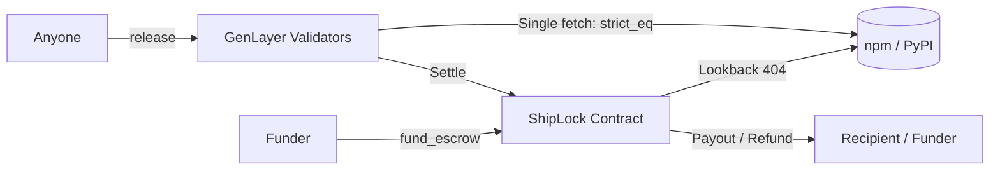
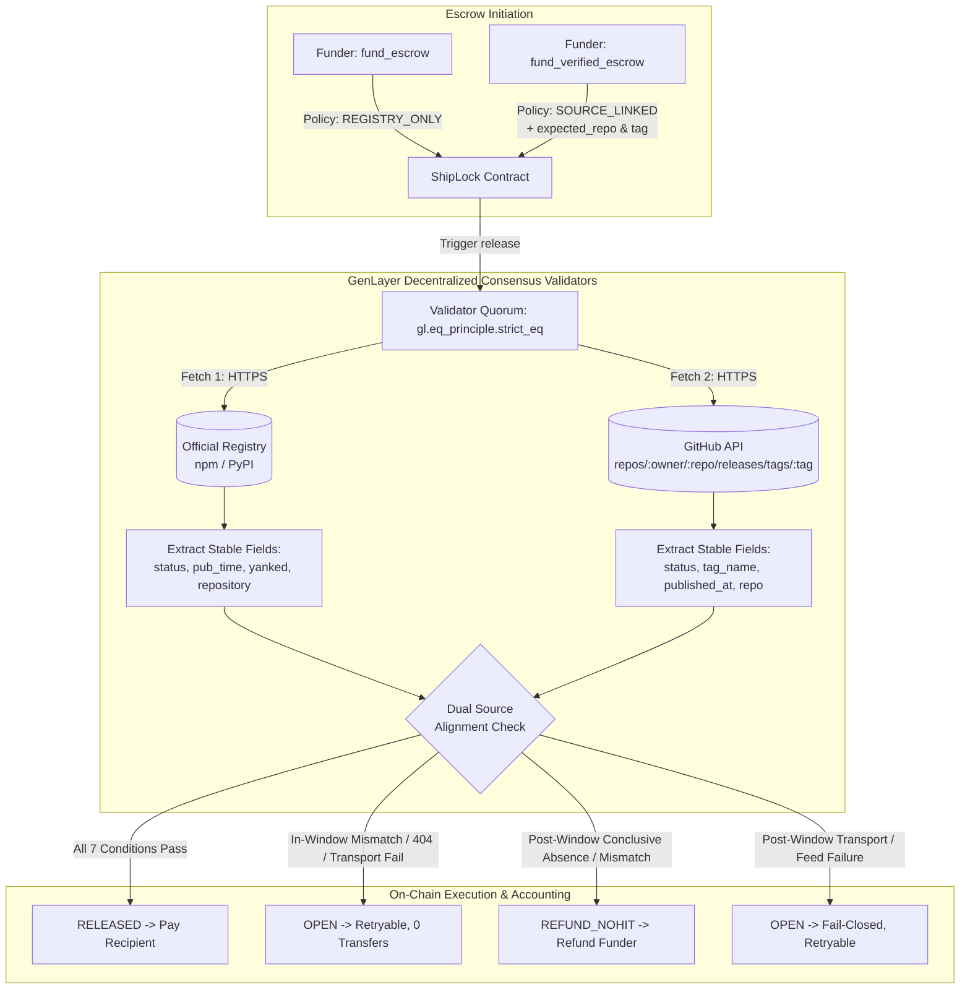

# Milestone 01: ShipLock Verified Release v2 — Source-Linked Multi-Source Release Verification

## 1. Milestone Overview

- **Milestone Title**: ShipLock Verified Release v2 — Source-Linked Multi-Source Release Verification
- **Accepted Baseline HEAD SHA**: `0617a800a0cabde7d1e324df110bfd3c8b7ac138`
- **Verification Policy**: `SOURCE_LINKED` ("Source-Linked Verified Release") vs `REGISTRY_ONLY` ("Registry Release")
- **Implementation Status**: Complete in working tree; verified via automated contract, evidence harness, and frontend suites.

---

## 2. Why This Change Is Substantial

The baseline version of ShipLock verified time-gated release escrows solely against a single public package registry (either PyPI or npm). While effective for basic publication gating, relying exclusively on registry metadata introduces vulnerability to registry-side account compromises or unlinked package uploads where an artifact is published without corresponding open-source repository release tags.

**ShipLock Verified Release v2** introduces multi-source release verification enforced directly by GenLayer decentralized consensus validators:
1. **Dual Independent Evidence Sourcing**: During settlement, validators independently retrieve authoritative metadata from both the package registry (npm or PyPI) AND the project's canonical GitHub repository release API (`https://api.github.com/repos/{owner}/{repo}/releases/tags/{tag}`).
2. **Cross-Source Semantic Alignment**: Validators verify that:
   - The package version was published on the registry within the escrow's UTC window `[start_utc, end_utc]`.
   - The package version is not yanked.
   - The registry record's repository metadata matches the escrow's immutable expected GitHub repository.
   - The GitHub release tag exists, is not a draft, and exact tag name matches `expected_tag`.
   - The GitHub release publication timestamp falls within `[start_utc, end_utc]`.
3. **Honest Terminology & Qualification**: This policy is strictly designated as **Source-Linked Verified Release**. Matching registry metadata and GitHub release evidence establishes verifiable *source linkage*; it does not prove cryptographic build provenance (which would require verifying a signed cryptographic attestation such as SLSA provenance or Sigstore signatures).
4. **Strict Backward Compatibility**: The existing `fund_escrow` write path and registry-only settlement behavior remain 100% operational for existing users and automated workflows.

---

## 3. Before & After Architecture

### Before (ShipLock v1)


### After (ShipLock v2)


---

## 4. Contract & Public API Changes

### 1. New Public Write: `fund_verified_escrow`
```python
@gl.public.write
def fund_verified_escrow(
    self,
    template: str,
    package: str,
    version: str,
    expected_repo: str,
    expected_tag: str,
    recipient: str,
    window_start: str,
    window_end: str,
    nonce: int = 0
) -> str:
```
- **Preimage & Deterministic ID**: Derived via SHA-256 over an 11-element preimage:
  `{funder_hex}|{payee_hex}|{template}|{package}|{version}|{canon_repo}|{canon_tag}|{window_start}|{window_end}|{amount}|{nonce}`
- **Preserved Existing Write**: `fund_escrow(template, package, version, recipient, window_start, window_end, nonce)` is behaviorally preserved, populating legacy default coordinates with `policy = POLICY_REGISTRY_ONLY`, empty expected repo/tag, and maintaining 100% backward compatibility.

### 2. Strict Input Validation on GitHub Repo & Tag
- **`expected_repo` validation**:
  - Requires canonical `owner/repo` syntax (exactly one forward slash).
  - Rejects traversal (`..`), URL schemes (`https://`), query strings (`?`), fragments (`#`), control characters, and whitespace.
  - Bounds length strictly `[3, 128]` characters.
- **`expected_tag` validation**:
  - Rejects path separators (`/`), path traversal (`..`), spaces, control characters, and dangerous git ref characters (`~`, `^`, `:`, `?`, `*`, `[`, `\`, `@{`).
  - Bounds length strictly `[1, 128]` characters.

### 3. Extended Escrow Storage & Audit View (`get_escrow`)
Each escrow stores and returns immutable audit fields:
- `policy`: `"SOURCE_LINKED"` or `"REGISTRY_ONLY"`
- `expected_repo`: Canonical GitHub owner/repo (e.g. `"shiplock-org/shiplock-core"`)
- `expected_tag`: Canonical Git release tag (e.g. `"v1.0.0"`)
- `registry_evidence`: JSON-encoded normalized registry verification record
- `github_evidence`: JSON-encoded normalized GitHub release verification record
- `match_reason`: Precise reason code describing the settlement decision

### 4. Canonical Git URL Normalizer (`_normalize_github_repo_url`)
Handles and canonicalizes diverse repository metadata representations found across npm `package.json` and PyPI `project_urls`:
- `https://github.com/owner/repo.git` → `owner/repo`
- `git+https://github.com/owner/repo` → `owner/repo`
- `git@github.com:owner/repo.git` → `owner/repo`
- `ssh://git@github.com/owner/repo.git` → `owner/repo`
- `github:owner/repo` → `owner/repo`
- `owner/repo` → `owner/repo`

---

## 5. Consensus & Fail-Closed Design

All network access is executed within GenLayer's non-deterministic equivalence principle:
```python
def run():
    reg_meta = _fetch_and_parse_registry(e.template, e.package_name, e.version)
    gh_owner, gh_repo = e.expected_repo.split("/", 1)
    gh_meta = fetch_github_release(gh_owner, gh_repo, e.expected_tag)
    return json.dumps({
        "registry": reg_meta,
        "github": gh_meta
    }, sort_keys=True)

all_ev_str = gl.eq_principle.strict_eq(run)
```

### Precise Reason Codes
| Settlement Condition | Timing | State | Reason Code | Outcome |
|---|---|---|---|---|
| All 7 conditions verified | Inside window or post-window | `RELEASED` | `VERIFIED_RELEASE` | Pays recipient `amount` |
| GitHub release not found (404) | Active window (`now < end`) | `OPEN` | `EARLY_GITHUB_404_RETRYABLE` | Retryable; 0 transfer |
| Registry repo mismatch | Active window (`now < end`) | `OPEN` | `EARLY_REGISTRY_MISMATCH_RETRYABLE` | Retryable; 0 transfer |
| GitHub tag mismatch | Active window (`now < end`) | `OPEN` | `EARLY_GITHUB_TAG_MISMATCH_RETRYABLE` | Retryable; 0 transfer |
| GitHub transport error (403/429/5xx) | Active window (`now < end`) | `OPEN` | `EARLY_GITHUB_UNAVAILABLE_RETRYABLE` | Retryable; 0 transfer |
| Registry transport error | Active window (`now < end`) | `OPEN` | `EARLY_REGISTRY_UNAVAILABLE_RETRYABLE` | Retryable; 0 transfer |
| Conclusive GitHub 404 | After window (`now >= end`) | `REFUND_NOHIT` | `WINDOW_EXPIRED_GITHUB_NO_RELEASE` | Refunds funder `amount` |
| Conclusive repo mismatch | After window (`now >= end`) | `REFUND_NOHIT` | `REGISTRY_REPO_MISMATCH` | Refunds funder `amount` |
| Conclusive tag mismatch | After window (`now >= end`) | `REFUND_NOHIT` | `GITHUB_TAG_MISMATCH` | Refunds funder `amount` |
| Transport failure / inconclusive | After window (`now >= end`) | `OPEN` | `POST_WINDOW_GITHUB_UNAVAILABLE` | Fail-closed; retryable |

---

## 6. Threat Model & Security Invariants

1. **Fail-Closed on Evidence Incompleteness**: Transport timeouts, rate limits (HTTP 429), server errors (5xx), redirects, oversized bodies (>256 KiB), and non-JSON responses NEVER cause settlement. The escrow remains `OPEN`.
2. **Protection Against Hostile URL Injection**: Validators never accept user-provided URLs. Target URLs are constructed internally using sanitized canonical components (`https://api.github.com/repos/{owner}/{repo}/releases/tags/{tag}`).
3. **No Double Settlement / Replay**: Once an escrow transitions to `RELEASED`, `REFUND_NOHIT`, `CANCELED`, or `EXPIRED`, all further calls to `release` or `expire` revert immediately (`"not OPEN"`).
4. **Funder Self-Release Prevention**: Calls to `release` from the funder address revert with `UserError("Funder cannot release")`.
5. **Exact Economics & Fee Bounds**: Escrow accounting strictly balances `escrowed_open + paid_to_recipients + refunded_to_funders == total_funded`.
6. **Two-Recipient Allocation Tree**: Release writes maintain a two-root allocation tree covering both `recipient` and `funder` to prevent Mode 1 out-of-gas failures during cross-boundary state transitions.

---

## 7. Verification Test Results

All verification suites executed locally against the implementation:

```bash
# 1. Direct Python Contract & Keystore Tests:
python -m pytest
# Result: 57 passed in 11.10s (44 direct contract tests + 13 deployer keystore tests)

# 2. Node Evidence Harness & Adversarial Simulation:
node --test tests/test_evidence_harness.mjs
# Result: 60 passed (11 suites, 0 failed, 0 skipped)

# 3. Next.js Web Integration & Runtime Tests:
npm --prefix web test
# Result: 74 passed (16 suites, 0 failed, 0 skipped)

# 4. Web Linter:
npm --prefix web run lint
# Result: 0 errors (18 pre-existing warnings)

# 5. Production Web Build:
npm --prefix web run build
# Result: Compiled successfully via Next.js 16.3.6 Turbopack
```

---

## 8. Files Touched

| File | Role |
|---|---|
| `contracts/shiplock.py` | Implements `SOURCE_LINKED` policy, `fund_verified_escrow`, canonical repo/tag validation, dual-source consensus settlement, and audit views. |
| `fee-profile.json` | Configures `fund_verified_escrow` with 200 leader / 400 validator timeunits within Studio Next `[30, 600]` bounds. |
| `scripts/evidence_helper.mjs` | Implements off-chain verification helpers for repo/tag validation, URL normalization, and GitHub release parsing. |
| `tests/direct/conftest.py` | Configures test runner with GenVM `v0.6.0-rc8` parity. |
| `tests/direct/utils.py` | Enhances mock registry with multi-pattern dictionary routing for dual-source consensus simulation. |
| `tests/direct/test_shiplock.py` | Adds 8 comprehensive direct contract test suites covering input rejections, deterministic IDs, verified release, active-window retryability, and post-window conclusive refunds. |
| `tests/test_evidence_harness.mjs` | Adds Suite 10 covering adversarial repo/tag attacks, URL normalization, and dual-source consensus simulation. |
| `web/src/fee-profile.json` | Synchronizes frontend fee profile with 200/400 allocations for `fund_verified_escrow`. |
| `web/src/lib/escrow.ts` | Implements client-side repo/tag validation and 11-element preimage derivation for `SOURCE_LINKED` escrows. |
| `web/src/lib/write.ts` | Updates `verifyCreatedEscrow` to validate `policy`, `expectedRepo`, and `expectedTag` on-chain. |
| `web/src/app/lock/page.tsx` | Adds policy selector ("Source-Linked Verified Release" vs "Registry Release"), GitHub inputs, live client-side validation, and review modal. |
| `web/src/app/escrow/[id]/page.tsx` | Adds policy badge, GitHub repo/tag links, dual-source evidence inspection cards, and clear retryable reason notices. |
| `web/src/app/browse/page.tsx` | Displays policy badge and repository target on escrow list cards. |
| `web/src/app/me/page.tsx` | Displays policy badge and repository target on user's personal lock cards. |
| `web/test/flow.test.ts` | Adds Section 8 testing client-side validation, 11-element preimage derivation, fee profile allocations, and `verifyCreatedEscrow`. |
| `README.md` | Documents the Source-Linked Verified Release policy, API signatures, and updated test counts. |
| `TESTCASES.md` | Documents verified escrow test cases and procedures. |
| `EVIDENCE.md` | Appends Milestone v2 section with pending live deployment steps while preserving all historical evidence. |
| `MILESTONE_01.md` | Comprehensive milestone report and specification. |

---

## 9. Honest Limitations

1. **Not Cryptographic Build Provenance**: Verification matches package registry metadata with GitHub release tags and publication timestamps. It establishes that an official release tag and package publish occurred in the same authorized window for matching repositories. It does not inspect cryptographic build provenance or signed commit attestations (e.g., Sigstore/in-toto SLSA attestations).
2. **GitHub API Rate Limits**: GitHub's unauthenticated public API is subject to rate limiting (60 requests/hr per IP). Validators encountering HTTP 403/429 fail closed and leave the escrow `OPEN` until rate limits reset.
3. **Draft Releases Excluded**: GitHub releases flagged as `"draft": true` are treated as unpublished and will not trigger settlement.

---

## 10. Live Verification Status

### On-Chain Contract Deployment (Verified)
- **Milestone v2 Contract Address**: [`0xF2110c3E6B170caF10FE953564285C6f01cB1F0c`](https://explorer-studio-dev.genlayer.com/address/0xF2110c3E6B170caF10FE953564285C6f01cB1F0c)
- **Deployment Transaction Hash**: [`0x6874241737bf6b45f0e5f71211a5923bb02e6c8b715b15ed606a405d4a28182f`](https://explorer-studio-dev.genlayer.com/transactions/0x6874241737bf6b45f0e5f71211a5923bb02e6c8b715b15ed606a405d4a28182f)
- **Receipt Status**: `FINALIZED` (Status Code 7)
- **Execution Result**: `FINISHED_WITH_RETURN` (Execution Result Code 1)
- **Consensus Round Outcome**: `MAJORITY_AGREE` (5/5 revealed validator votes)
- **Source Parity Status**: `EXACT UTF-8 BYTE MATCH` (51,327 local bytes == 51,327 on-chain bytes; SHA-256: `860387dc9579aba8d445df9395c4ec80bc425b7b8a3d7b27eed8cc477b59276d`)
- **Deployer Public Address**: `0x20E850BAaD26d763d4f691780D1BEBA01c8D6084`
- **Network / Chain ID**: GenLayer Studio Devnet / Studio Next (`61997`)

### Verified Production Web Deployment
- **Live Application Deployment**: Verified live (Status: Ready / Production)
  - **Production Alias**: [https://shiplock-chi.vercel.app](https://shiplock-chi.vercel.app)
  - **Deployment URL**: [https://shiplock-7xwj3qiap-edwarderlicks-projects.vercel.app](https://shiplock-7xwj3qiap-edwarderlicks-projects.vercel.app)
  - **Deployment ID**: `dpl_CV5iGz1n2hYAbTKqJHDvDvNdTJcu`

### Live Escrow Funding & Evidence (Phase C2/C3 Verified Live State)
Two live `SOURCE_LINKED` escrows have been funded and verified on GenLayer Studio Next (`61997`) under contract `0xF2110c3E6B170caF10FE953564285C6f01cB1F0c`:

1. **SUCCESS Escrow (In-Window Verified Release Target)**:
   - **Case Name**: `success`
   - **Policy**: `SOURCE_LINKED`
   - **Escrow ID**: `0x5c751544da2e5d505dbdb118ca2fb94e53091bb28493c236889ae69fc78a909d`
   - **Funding Transaction**: [`0x86538668726638307a4897eb2fcb89ccd4d2ce642fc42abf10abab6ea8cf9726`](https://explorer-studio-dev.genlayer.com/transactions/0x86538668726638307a4897eb2fcb89ccd4d2ce642fc42abf10abab6ea8cf9726)
   - **Funding Status**: `FINALIZED` / `FINISHED_WITH_RETURN`
   - **On-Chain State**: `OPEN` (`LOOKBACK_404_OK`, `10000000000000000` wei / 0.01 GEN locked)
   - **Template & Package**: `NPM_VERSION` / `shiplock-v2-evidence-f2110c3e` @ `1.0.0`
   - **Expected Repo & Tag**: `edwarderlick/shiplock` / `shiplock-evidence-v2-success-f2110c3e`
   - **Publication Window**: `2026-10-21T06:58:31Z` to `2026-10-23T06:58:31Z`
   - **Nonce**: `1001`
   - **Recovery Provenance**: Captured via authoritative `EXCLUSIVE_STATE_RECOVERY` audit (`2026-10-20T07:27:35.665Z`) with all 10 exclusive state assertions verified (single escrow on-chain, 0.01 GEN open economics, pre-state zero economics, immutable identity match, mismatch unfunded at recovery time, external coordinates absent).

2. **MISMATCH Escrow (Post-Window Conclusive Refund Target)**:
   - **Case Name**: `mismatch`
   - **Policy**: `SOURCE_LINKED`
   - **Escrow ID**: `0xdb592d59e4dbc85926eac234ba3c92677ec2f42aeb4de1f1430cf9454d7a5a88`
   - **Funding Transaction**: [`0xa0acb2c81ef7e8aaae6d0f826f0ca6101904a337a1ef797d22855ade0d68ecf0`](https://explorer-studio-dev.genlayer.com/transactions/0xa0acb2c81ef7e8aaae6d0f826f0ca6101904a337a1ef797d22855ade0d68ecf0)
   - **Funding Status**: `FINALIZED` / `FINISHED_WITH_RETURN`
   - **On-Chain State**: `OPEN` (`LOOKBACK_404_OK`, `10000000000000000` wei / 0.01 GEN locked)
   - **Template & Package**: `NPM_VERSION` / `shiplock-v2-no-release-f2110c3e` @ `1.0.0`
   - **Expected Repo & Tag**: `edwarderlick/shiplock` / `shiplock-evidence-v2-missing-f2110c3e`
   - **Publication Window**: `2026-10-21T11:20:26Z` to `2026-10-23T11:20:26Z`
   - **Nonce**: `1002`
   - **Immediate Capture Provenance**: Verified immediately post-funding (`2026-10-20T09:21:13.367Z`) with pre-economics snapshot `escrowed_open = 10000000000000000` wei and post-economics snapshot `escrowed_open = 20000000000000000` wei.

3. **Common Publication Interval & Current Economics**:
   - **Common Publication Interval**:
     - UTC: `2026-10-21T11:20:26Z` through `2026-10-23T06:58:31Z`
     - IST: `2026-10-21 16:50:26` through `2026-10-23 12:28:31`
     - Overlap Duration: 43 hours, 38 minutes, 5 seconds.
   - **Two-Escrow Aggregate Economics (`get_economics()`)**:
     - `escrowed_open`: `20000000000000000` wei (`0.02 GEN`)
     - `paid_to_recipients`: `0 wei`
     - `refunded_to_funders`: `0 wei`
     - `outstanding_credits`: `0 wei`
     - `treasury`: `0 wei`

### Publication & Settlement Invariants (Phase C4 Status: PENDING)
- **Zero Publication Invariant (Phase C4A)**: Both npm packages (`shiplock-v2-evidence-f2110c3e@1.0.0`, `shiplock-v2-no-release-f2110c3e@1.0.0`) and the SUCCESS GitHub release tag (`shiplock-evidence-v2-success-f2110c3e`) are verified strictly unpublished (HTTP 404 confirmed).
- **Prohibited Tag Invariant**: The MISMATCH release tag `shiplock-evidence-v2-missing-f2110c3e` must **NEVER** be created on GitHub or in git, ensuring the controlled missing-release condition holds for post-window refund.
- **Pending Phase C4 Operations**:
  - Publication to npm and GitHub release tag creation will occur strictly within the common publication window (`2026-10-21T11:20:26Z` to `2026-10-23T06:58:31Z`).
  - In-window verified release settlement (`release` call) remains **PENDING**.
  - Post-window refund settlement (`release` call after `2026-10-23T11:20:26Z`) remains **PENDING**.
  - Child transfer transaction verifications remain **PENDING**.
  - Zero premature settlement or release success is claimed.
